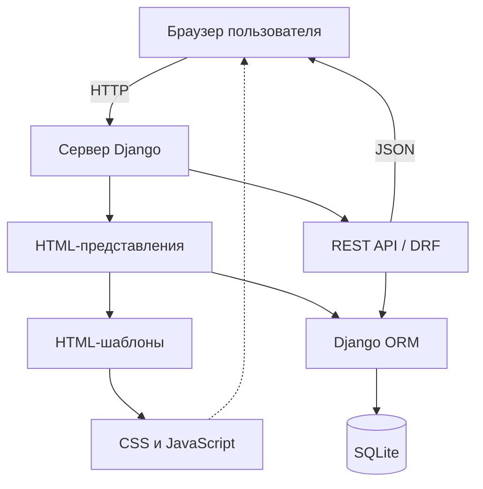

# Архитектура приложения

## 1. Назначение системы

Проект представляет собой веб-приложение для бронирования оборудования.
Пользователь может просматривать доступное оборудование, создавать бронирования, подтверждать их, завершать и просматривать историю действий.

## 2. Используемые технологии

- Python 3.13.7 — язык программирования.
- Django 6.1.3 — веб-фреймворк.
- Django REST Framework 3.18.3 — REST API.
- SQLite — локальная база данных.
- HTML, CSS, JavaScript — интерфейс пользователя.
- Django ORM — взаимодействие с базой данных.

## 3. Основные компоненты

### Браузер

Отображает HTML-страницы, выполняет HTTP-запросы и получает ответы сервера.

### Django

Обрабатывает запросы пользователя, выполняет серверную логику, проверяет авторизацию и взаимодействует с базой данных.

### REST API

Реализован с помощью Django REST Framework.

Основные компоненты:
- EquipmentViewSet;
- ReservationViewSet;
- EquipmentStatisticsView.

API использует JSON для передачи данных.

### Django ORM

Обеспечивает доступ к данным через модели Python.

### База данных

Локально используется SQLite.

Основные модели:
- Equipment;
- Reservation;
- ReservationEvent.

### Статические файлы

CSS, JavaScript и другие ресурсы используются для оформления и работы интерфейса.

## 4. Структура проекта

accounts/ — авторизация, пользовательские функции и интерфейс.

config/ — основные настройки Django и маршрутизация.

reservations/ — модели оборудования, бронирования, REST API, статистика и тесты.

static/ — общие статические файлы.

templates/ — HTML-шаблоны.

docs/ — техническая документация.

manage.py — управление Django-проектом.

db.sqlite3 — локальная база данных.

requirements.txt — зависимости Python.

README.md — общее описание проекта и инструкция запуска.

## 5. Обработка запросов

1. Пользователь открывает страницу приложения.
2. Браузер отправляет HTTP-запрос.
3. Django определяет маршрут запроса.
4. Представление обрабатывает запрос.
5. При необходимости выполняется обращение к базе данных через ORM.
6. Сервер возвращает HTML-страницу или JSON.
7. Браузер отображает результат.

## 6. Обработка бронирования

При подтверждении бронирования:
1. Проверяется авторизация пользователя.
2. Проверяется текущее состояние бронирования.
3. Проверяется доступное количество оборудования.
4. Уменьшается доступный остаток.
5. Изменяется статус бронирования.
6. Создаётся запись истории.

Операция выполняется внутри транзакции.
Если возникает ошибка, изменения транзакции откатываются.

## 7. Безопасность

В REST API используется проверка IsAuthenticated.
Пользователь может просматривать и изменять только собственные бронирования.
Для изменяющих запросов при сессионной авторизации используется CSRF-защита.

## 8. Схема архитектуры

## 9. Вывод

Архитектура проекта разделяет пользовательский интерфейс, серверную логику, REST API и хранение данных.
Такое разделение упрощает сопровождение приложения, его тестирование и документирование.
