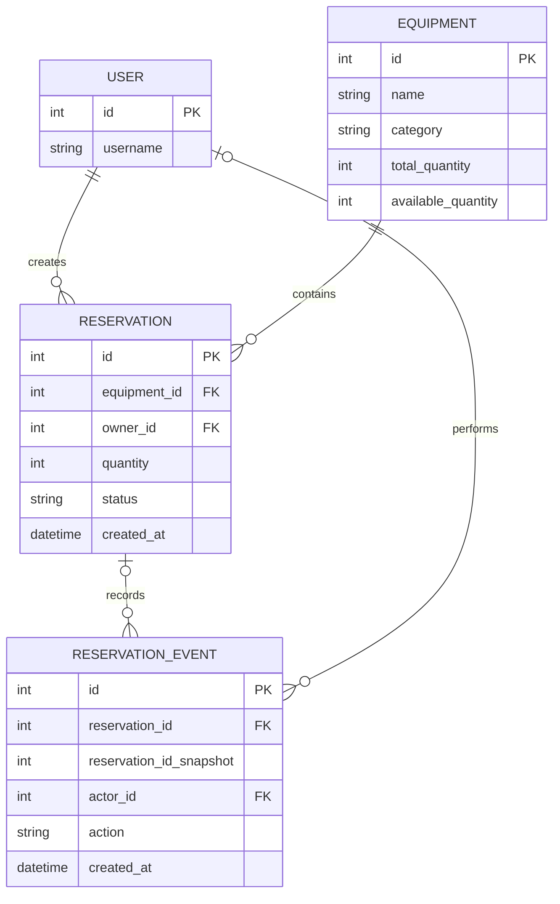

# Структура БД

## 1. Общая информация

В проекте используется Django ORM для работы с БД.
При локальном запуске применяется SQLite. Структура данных описана в файле `reservations/models.py`.

Основные модели приложения:
- Equipment - оборудование;
- Reservation - бронирование;
- ReservationEvent - история действий.

Для хранения пользователей используется модель пользователя, указанная в настройке AUTH_USER_MODEL.

## 2. Модель Equipment

Модель хранит информацию об оборудовании.

Основные поля:
- id - первичный ключ;
- name - название оборудования;
- category - категория;
- total_quantity - общее количество;
- available_quantity - доступное количество.

Для total_quantity установлено ограничение: значение должно быть не меньше 1.

## 3. Модель Reservation

Модель хранит информацию о бронировании оборудования.

Основные поля:
- id - первичный ключ;
- equipment - ссылка на оборудование;
- owner - пользователь, создавший бронирование;
- quantity - количество единиц оборудования;
- status - статус бронирования;
- created_at - дата и время создания.

Возможные статусы:
- created - создана;
- confirmed - подтверждена;
- completed - завершена.

Количество бронируемого оборудования должно быть не меньше 1.
Связь с Equipment реализована через ForeignKey с параметром on_delete=PROTECT.
Это предотвращает удаление оборудования, если на него ссылаются бронирования.

## 4. Модель ReservationEvent

Модель предназначена для хранения истории действий.

Основные поля:
- id - первичный ключ;
- reservation - ссылка на бронирование;
- reservation_id_snapshot - сохранённый идентификатор бронирования;
- actor - пользователь, выполнивший действие;
- action - название действия;
- created_at - дата и время события.

Для связи с Reservation используется on_delete=SET_NULL.
При удалении бронирования ссылка в событии может стать пустой, но сама запись истории сохраняется.
Поле reservation_id_snapshot позволяет хранить идентификатор исходного бронирования независимо от наличия связи.

## 5. Связи между моделями

- Одному оборудованию может соответствовать несколько бронирований.
- Один пользователь может создать несколько бронирований.
- Одному бронированию может соответствовать несколько событий.
- Один пользователь может быть исполнителем нескольких событий.

Связи реализованы с помощью ForeignKey.

## 6. Миграции

Для создания и обновления структуры БД используются миграции Django.

Проверка миграций:

    python manage.py showmigrations

Применение миграций:

    python manage.py migrate

При проверке проекта все отображённые миграции были применены успешно.

## 7. Схема связей базы данных

## 8. Вывод

Структура базы данных позволяет хранить сведения об оборудовании, бронированиях и истории действий пользователей.
Использование внешних ключей обеспечивает связи между сущностями, а миграции Django позволяют воспроизводить структуру БД при развёртывании проекта.
